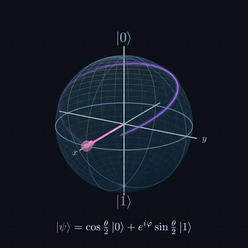

## Tiago Rodrigues

**Estudante de Física | Computação Quântica | Python**
 
<i>Physics Student | Quantum Computing | Python</i>

 

<!-- Cartões gerados por https://github.com/pedrocatalao/github-cool-readme (workflow .github/workflows/cool-readme.yml) -->

<picture>
  <source media="(prefers-color-scheme: dark)" srcset="https://raw.githubusercontent.com/TiagoRodriguesskt/TiagoRodriguesskt/cards/about-dark.svg">
  
</picture>
<picture>
  <source media="(prefers-color-scheme: dark)" srcset="https://raw.githubusercontent.com/TiagoRodriguesskt/TiagoRodriguesskt/cards/summary-dark.svg">
  
</picture>

<picture>
  <source media="(prefers-color-scheme: dark)" srcset="https://raw.githubusercontent.com/TiagoRodriguesskt/TiagoRodriguesskt/cards/languages-dark.svg">
  
</picture>
<picture>
  <source media="(prefers-color-scheme: dark)" srcset="https://raw.githubusercontent.com/TiagoRodriguesskt/TiagoRodriguesskt/cards/weekly-dark.svg">
  
</picture>

<picture>
  <source media="(prefers-color-scheme: dark)" srcset="https://raw.githubusercontent.com/TiagoRodriguesskt/TiagoRodriguesskt/cards/streaks-dark.svg">
  
</picture>
<picture>
  <source media="(prefers-color-scheme: dark)" srcset="https://raw.githubusercontent.com/TiagoRodriguesskt/TiagoRodriguesskt/cards/repos-dark.svg">
  
</picture>

### Áreas de estudo · *Fields of study*

- Física Computacional · *Computational Physics*
- Computação Quântica · *Quantum Computing*
- Matemática aplicada à Física · *Mathematical Physics*
- Programação científica em Python · *Scientific programming in Python*

### Ferramentas · *Tech Stack*

  &nbsp;
  &nbsp;
  &nbsp;
  &nbsp;
  &nbsp;
  &nbsp;
  &nbsp;
  &nbsp;
  

---

  Aberto a colaborações em pesquisa · <i>Open to research collaborations</i>

