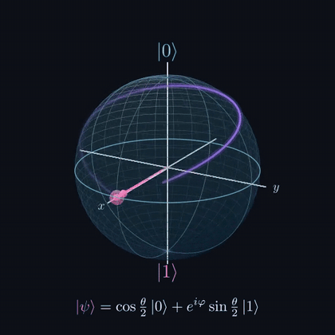

## Tiago Rodrigues

**Estudante de Física | Computação Quântica | Python**
 
<i>Physics Student | Quantum Computing | Python</i>

 

---

### Sobre mim · *About me*

Estudante de **Física e Matemática**, com graduação e pós-graduação em andamento e interesse em pesquisa nas áreas de **Computação Quântica** e **Física Computacional**. Uso Python para simulações e análise de dados e LaTeX para a escrita de artigos científicos.

> *Physics and Mathematics student, currently pursuing undergraduate and graduate studies, with research interests in **Quantum Computing** and **Computational Physics**. I use Python for simulations and data analysis, and LaTeX for writing scientific papers.*

### Áreas de estudo · *Fields of study*

- Física Computacional · *Computational Physics*
- Computação Quântica · *Quantum Computing*
- Matemática aplicada à Física · *Mathematical Physics*
- Programação científica em Python · *Scientific programming in Python*

### Ferramentas · *Tech Stack*

  &nbsp;
  &nbsp;
  &nbsp;
  &nbsp;
  &nbsp;
  &nbsp;
  &nbsp;
  &nbsp;
  

### Projeto em destaque · *Featured project*

**Portfólio:** [tiagorodriguesskt.github.io](https://tiagorodriguesskt.github.io)

### Estatísticas · *GitHub stats*

  
  

---

  Aberto a colaborações em pesquisa · <i>Open to research collaborations</i>

